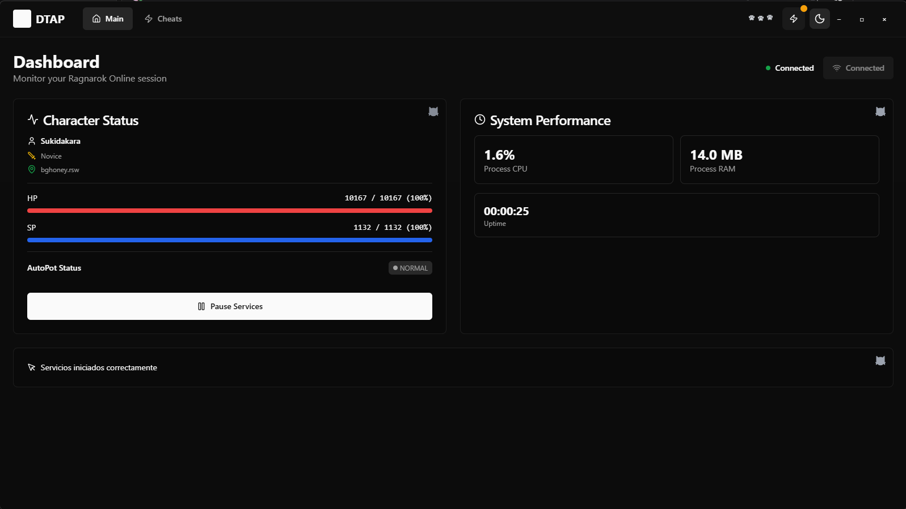
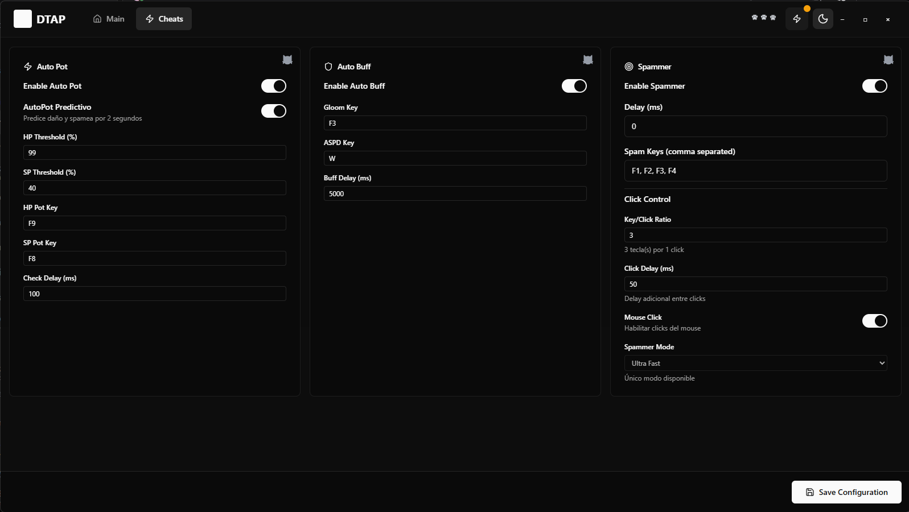
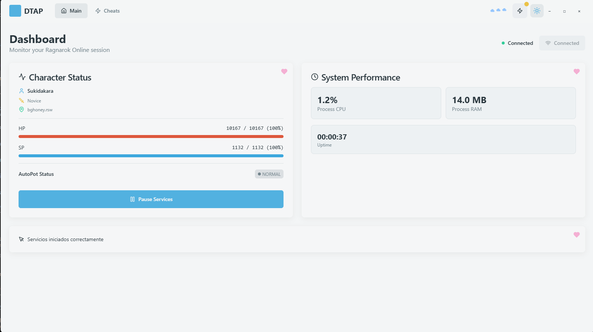
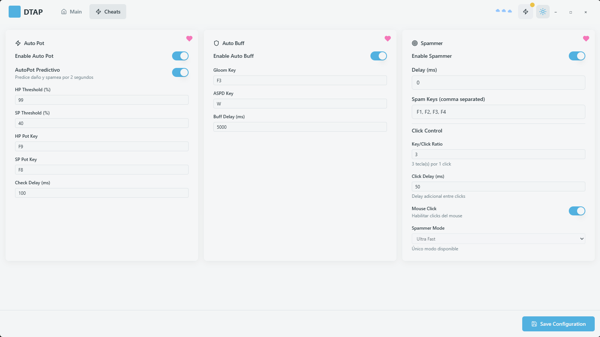

# DTAP - Ragnarok Online Assistant

Un asistente moderno para Ragnarok Online con **sistema de predicción inteligente** y interfaz gráfica intuitiva.

## 🙏 Créditos y Proyectos Base

Este proyecto ha tomado inspiración y código base de los siguientes proyectos de la comunidad:

- **[k1ngJ/dtAP](https://github.com/k1ngJ/dtAP)** - Proyecto original en C# que sirvió como base fundamental
- **[SmookyzX/SmookyzAP](https://github.com/SmookyzX/SmookyzAP)** - Autopotion avanzado con High Ping Mode
- **[4RTools/4RTools](https://github.com/4RTools/4RTools)** - Suite completa de herramientas para Ragnarok Online

Agradecemos a todos los desarrolladores de la comunidad por su trabajo y contribuciones al ecosistema de herramientas para Ragnarok Online.

## 🚀 Características

- **🧠 Predicción Inteligente**: Anticipa el daño 200ms antes usando regresión lineal
- **⚡ AutoPot Ultra Rápido**: Autopot con predicción de daño (15ms interval)
- **🎮 Spammer Optimizado**: Spammer de alta velocidad (10ms interval)
- **🔄 AutoBuff Inteligente**: Sistema de buffs automático (250ms interval)
- **🖥️ Interfaz Moderna**: GUI React/TypeScript con configuración visual
- **📊 Monitoreo en Vivo**: Estadísticas actualizadas a 60 FPS
- **🎨 Temas Personalizables**: Múltiples temas con transparencia
- **⚙️ Configuración en Tiempo Real**: Ajustes sin reiniciar

## 🖼️ Interfaz de Usuario

### Modo Oscuro



### Modo Claro



## 📁 Estructura del Proyecto

```
dtap-gui/
├── frontend/             # Interfaz React/TypeScript
│   ├── components/       # Componentes de la UI
│   ├── contexts/         # Contextos de React
│   ├── styles/           # Estilos CSS
│   └── pages/            # Páginas principales
├── internal/             # Lógica del backend
│   ├── autopot/          # Sistema de autopot
│   ├── spammer/          # Sistema de spammer
│   ├── autobuff/         # Sistema de autobuff
│   ├── memory/           # Acceso a memoria
│   ├── prediction/       # Sistema de predicción
│   └── services/         # Gestión de servicios
├── build/                # Archivos de build
└── main.go               # Punto de entrada
```

## 🛠️ Instalación

### Prerrequisitos
- **Go 1.21+**
- **Node.js 16+**
- **Wails v2**
- **Windows 10/11**

### Instalación
```bash
# Instalar Wails
go install github.com/wailsapp/wails/v2/cmd/wails@latest

# Clonar el repositorio
git clone <tu-repo>
cd dtap-gui

# Instalar dependencias
npm install

# Compilar
wails build

# Ejecutar en desarrollo
wails dev
```


## 🎮 Uso

1. **Ejecutar la aplicación**
   ```bash
   wails dev
   ```

2. **Conectar a Ragnarok Online**
   - Asegúrate de que RO esté ejecutándose
   - Haz clic en "Conectar" en la GUI

3. **Configurar servicios**
   - **AutoPot**: Configura teclas y porcentajes de HP/SP
   - **Spammer**: Configura teclas y delay
   - **AutoBuff**: Configura buffs automáticos

4. **Iniciar servicios**
   - Haz clic en "Iniciar" para activar los servicios
   - Los servicios se ejecutarán automáticamente

## ⚙️ Configuración

La configuración se realiza directamente desde la interfaz gráfica:

- **AutoPot**: Configura teclas de HP/SP y porcentajes
- **Spammer**: Configura teclas, delay y modo
- **AutoBuff**: Configura buffs y delays
- **Temas**: Cambia entre temas claro/oscuro
- **Transparencia**: Ajusta la transparencia de la ventana

Todos los cambios se aplican en tiempo real sin necesidad de reiniciar.


## 📊 Características Técnicas

- **Predicción de Daño**: Anticipa el daño 200ms antes usando regresión lineal
- **Alto Rendimiento**: AutoPot a 15ms, Spammer a 10ms, AutoBuff a 250ms
- **Optimizaciones de Sistema**: timeBeginPeriod(1) para máxima precisión
- **Interfaz Fluida**: Actualizaciones a 60 FPS sin lag
- **Acceso a Memoria**: Lectura directa de HP/SP del proceso de RO

## 🚨 Requisitos

- **Windows 10/11** (64-bit)
- **Ragnarok Online** ejecutándose
- **Permisos de administrador** (para acceso a memoria)
- **Go 1.21+** y **Node.js 16+** (para compilación)

## 🤝 Contribución

1. Fork el proyecto
2. Crea una rama para tu feature
3. Commit tus cambios
4. Push a la rama
5. Abre un Pull Request

## 📄 Licencia

Este proyecto está bajo la Licencia MIT.

---

**DTAP** - *Ragnarok Online Assistant* 🚀